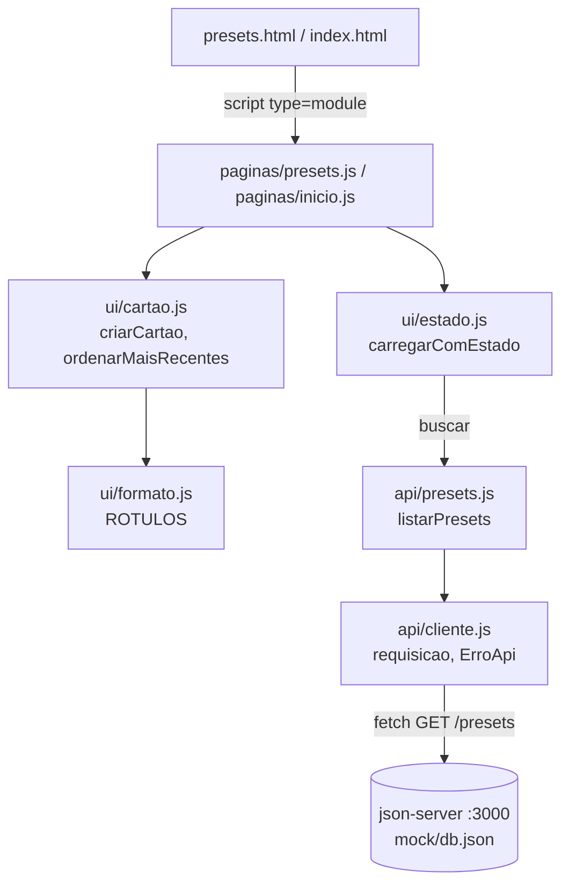

# Preset Catalogue from a Mock API, as ES Modules - Design

**Spec**: `.specs/features/etapa05-api-modulos/spec.md`
**Status**: Draft

---

## Architecture Overview

Pages import a page module; the page module asks `ui/estado.js` to run the request with loading and error handling; the request goes through `api/presets.js` to `api/cliente.js`, the only code that calls `fetch`. Data never touches `window`.



Dependency rule (AD-009): `paginas/` → `ui/` and `api/`; `ui/` never imports `api/`; `api/` imports nothing from the UI. `estado.js` receives the request as a function, so it stays reusable for the cart, checkout and library slices.

---

## Code Reuse Analysis

### Existing Components to Leverage

| Component | Location | How to Use |
| --------- | -------- | ---------- |
| `criarCartao`, `ordenarMaisRecentes` | `frontend/cartao.js:4-30` | Move unchanged to `frontend/ui/cartao.js`; `window.ROTULOS` becomes an import |
| `ROTULOS` | `frontend/dados.js:91-107` | Move to `frontend/ui/formato.js` as an export |
| Preset data (9 entries) | `frontend/dados.js:4-89` | Copy values verbatim into `mock/db.json` → `presets` |
| Filter / sort / render pipeline | `frontend/presets.js:14-79` | Move to `frontend/paginas/presets.js`; `window.PRESETS` becomes a module variable filled after the request |
| Carousel render | `frontend/inicio.js:2-7` | Move to `frontend/paginas/inicio.js` |
| Empty-state look | `.lista-vazia`, `.biblioteca-vazia` (`frontend/style.css:361-455`) | Reuse the same box for the loading and error messages |
| Static test server, viewport pattern | `playwright.config.js:20-31` | Keep; add json-server as a second `webServer` entry |

### Integration Points

| System | Integration Method |
| ------ | ------------------ |
| json-server 0.17.4 | `GET http://127.0.0.1:3000/presets`; CORS headers are on by default, so pages served from :8080 can call it |
| Playwright | `webServer` becomes an array (static :8080 + json-server :3000); tests control latency and failures with `page.route` and time with `page.clock` |

---

## Components

### `api/cliente.js`

- **Purpose**: The single place that performs HTTP and turns every failure into one error type.
- **Location**: `frontend/api/cliente.js`
- **Interfaces**:
  - `BASE_URL = 'http://127.0.0.1:3000'`
  - `TEMPO_LIMITE_MS = 8000`
  - `class ErroApi extends Error { status: number }` - `status` is the HTTP status, or `0` for network error / timeout
  - `requisicao(caminho: string, opcoes?: RequestInit): Promise<any>` - resolves with the parsed JSON; rejects with `ErroApi` on network error, timeout (AbortController), non-2xx, or invalid JSON; writes the original error to `console.error` before rejecting
- **Dependencies**: Fetch API, AbortController
- **Reuses**: none (new)

### `api/presets.js`

- **Purpose**: Catalogue endpoints.
- **Location**: `frontend/api/presets.js`
- **Interfaces**:
  - `listarPresets(): Promise<Preset[]>` - `GET /presets`; rejects with `ErroApi` (and logs) when the body is not an array
- **Dependencies**: `api/cliente.js`

### `ui/formato.js`

- **Purpose**: Display text for stored keys.
- **Location**: `frontend/ui/formato.js`
- **Interfaces**: `ROTULOS: { marca: Record<string,string>, estilo: Record<string,string> }`
- **Reuses**: `frontend/dados.js:91-107` verbatim

### `ui/cartao.js`

- **Purpose**: Card builder and default order, shared by both pages.
- **Location**: `frontend/ui/cartao.js`
- **Interfaces**: `criarCartao(preset): HTMLAnchorElement`, `ordenarMaisRecentes(lista): Preset[]`
- **Dependencies**: `ui/formato.js`
- **Reuses**: `frontend/cartao.js` verbatim, minus the IIFE and `window` assignments

### `ui/estado.js`

- **Purpose**: Show loading, then the result or an error with retry, in one status element.
- **Location**: `frontend/ui/estado.js`
- **Interfaces**:
  - `carregarComEstado({ alvo: HTMLElement, buscar: () => Promise<T>, aoCarregar: (dados: T) => void, mensagens: { carregando: string, erro: string } }): Promise<void>`
    - empties `alvo`, writes `<p role="status">{carregando}</p>`
    - on success: empties `alvo`, calls `aoCarregar(dados)`
    - on failure: empties `alvo`, writes `<div role="alert"><p>{erro}</p><button type="button">Tentar novamente</button></div>`; the button calls `carregarComEstado` again with the same arguments
  - Never throws; every rejection of `buscar` ends in the error state
- **Dependencies**: DOM only (no `api/` import - the request arrives as `buscar`)

### `paginas/presets.js`

- **Purpose**: Entry module for `presets.html`.
- **Location**: `frontend/paginas/presets.js`
- **Interfaces**: none exported. Holds `let catalogo = []`; `atualizar()` runs filter → sort → render over `catalogo`.
- **Behaviour**: while loading or in error, `#contagem` is empty and `.lista-vazia` stays hidden (LOAD-04, ERR-06); `atualizar()` is a no-op until the first success, which sets `catalogo` and calls `atualizar()` with whatever the controls hold at that moment (EDGE-01).
- **Reuses**: `frontend/presets.js:14-79`

### `paginas/inicio.js`

- **Purpose**: Entry module for `index.html`.
- **Location**: `frontend/paginas/inicio.js`
- **Reuses**: `frontend/inicio.js`

### Markup

- `presets.html`: new `<div class="estado-carga"></div>` above `.grade-presets`; the three classic `<script defer>` tags become one `<script type="module" src="paginas/presets.js">`.
- `index.html`: new `<div class="estado-carga"></div>` before `.carrossel`; one module script.
- `login.html`: unchanged (classic script; not part of this slice).

---

## Data Models

### Preset (`mock/db.json` → `presets`)

```typescript
interface Preset {
  id: number
  nome: string
  marca: 'boss' | 'line6' | 'nux' | 'mooer' | 'zoom' | 'headrush' | 'valeton' | 'hotone'
  equipamento: string
  estilo: 'rock' | 'blues' | 'metal' | 'clean'
  data: string        // ISO YYYY-MM-DD
  descricao: string
}
```

Same 9 entries and values as `frontend/dados.js`, kept out of date order (the sort tests rely on it).

---

## Error Handling Strategy

| Error Scenario | Handling | User Impact |
| -------------- | -------- | ----------- |
| Server down / DNS / CORS | `fetch` rejects → `ErroApi(0)` | Error message + "Tentar novamente" |
| No answer in 8000 ms | AbortController aborts → `ErroApi(0)` | Same |
| HTTP 4xx / 5xx | `!resposta.ok` → `ErroApi(status)` | Same |
| Body not JSON | `resposta.json()` rejects → `ErroApi(status)` | Same |
| Body JSON but not an array | `listarPresets` → `ErroApi(200)` | Same |
| Empty array | Success | "0 presets encontrados" + existing empty state |
| Any failure | `console.error(original)` in the API layer | Developer sees the real cause in the console |

One message for every failure: the visitor's action is the same in each case (retry), and the precise cause goes to the console.

---

## Risks & Concerns

| Concern | Location (file:line) | Impact | Mitigation |
| ------- | -------------------- | ------ | ---------- |
| Tests read expected data from `window.PRESETS` | `tests/presets-lista.spec.js:12-13, 21, 37, 117, 269, 277, 287, 313` | 8 call sites break once the global is gone | Replace with one helper that reads `GET /presets` through Playwright's `request` fixture - the tests keep deriving expectations from the data source, now the API (T3) |
| Silent early return when data is missing | `frontend/presets.js:11` | A missing global shows an empty page with no message | Removed: the page module always ends in list, empty state or error state |
| Reused server on port 3000 | `playwright.config.js:30` pattern (`reuseExistingServer`) | A dev `npm run api` with an edited `db.json` makes tests read that data | Tests derive expectations from the API, not hard-coded copies; the db reset arrives with the first write (slice 2) |
| Testing the 8 s timeout | ERR-03 | A real wait makes the suite slower and flaky | `page.clock.install()` + `fastForward(8001)` against a route that never answers |
| Static server exposes `mock/db.json` | `playwright.config.js:27` serves the repo root | Anyone can read the mock data | Accepted for a mock; real protection is the Spring Boot back end (see `plano.md`, security note) |

---

## Tech Decisions

| Decision | Choice | Rationale |
| -------- | ------ | --------- |
| Where the error is logged | `api/cliente.js` (and `api/presets.js` for the non-array case) | The layer that sees the raw error logs it; the UI only shows text |
| Retry implementation | The error button re-calls `carregarComEstado` with the same arguments | No retry state to keep in the page; the next attempt replaces the error node, so it cannot duplicate (EDGE-02) |
| API module tests | Import the module inside the page with `page.evaluate(() => import('./api/presets.js'))` | Tests the API layer alone in a real browser, without a second test runner |
| Static rule tests (MOD-02, MOD-03 source half) | A Playwright spec that reads `frontend/**/*.js` with Node `fs` | The rule is about source code, not the page; no extra tool needed |

> Project-level decisions **AD-008** (catalogue from the API, supersedes AD-006) and **AD-009** (ES modules with layered folders) are recorded in `.specs/STATE.md`.
