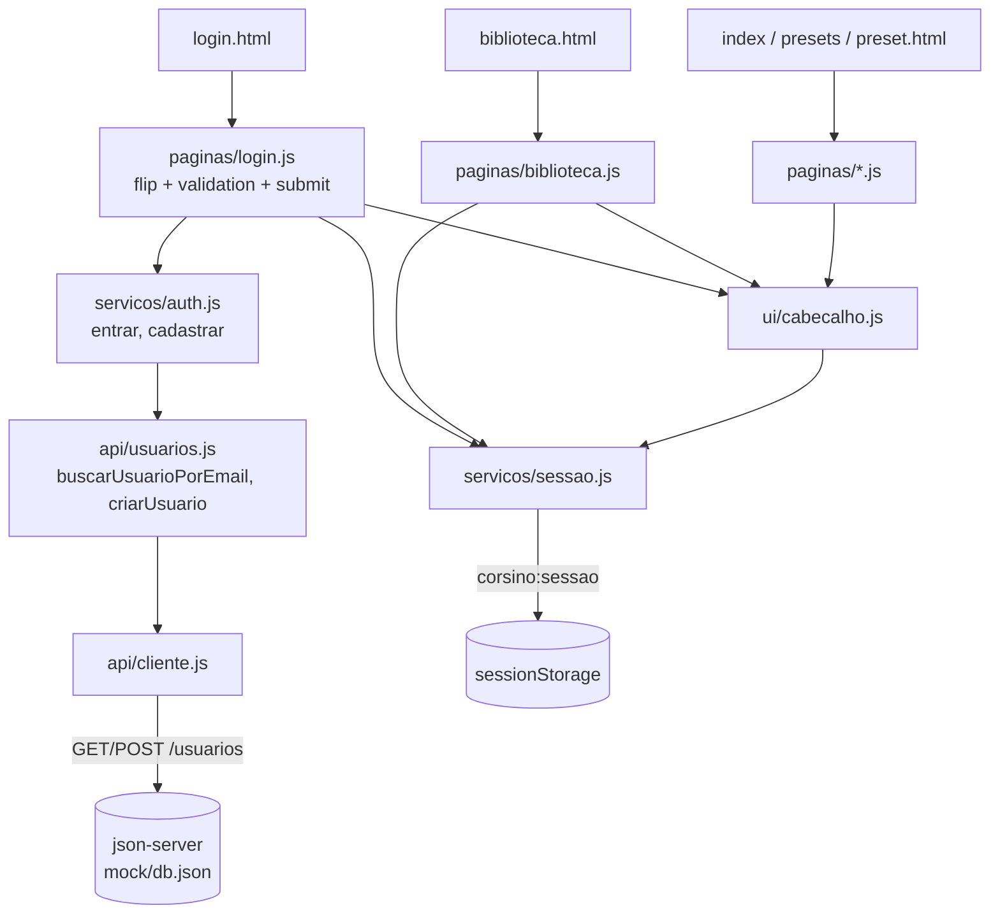

# Login, Registration and Session - Design

**Spec**: `.specs/features/etapa05-auth/spec.md`
**Status**: Draft

---

## Architecture Overview

Follows AD-009. Pages call `servicos/`; `servicos/auth.js` holds the login and registration rules and calls `api/usuarios.js`; `servicos/sessao.js` is the only code that touches `sessionStorage`; `ui/cabecalho.js` reads the session to draw the header.



`ui/cabecalho.js` imports `servicos/sessao.js`. AD-009 allows `ui/` → `servicos/` (it forbids only `ui/` → `api/`).

---

## Code Reuse Analysis

| Component | Location | How to Use |
| --------- | -------- | ---------- |
| Flip and field validation | `frontend/login.js:3-121` | Move to `frontend/paginas/login.js` (module). The flip IIFE, `regras`, `mostrarErro` and `limparErro` stay as they are; only `aoEnviar` changes (it now calls `servicos/auth.js`). The `sucesso` messages and `.mensagem-sucesso` elements are removed (VAL-06 superseded) |
| `requisicao`, `ErroApi` | `frontend/api/cliente.js` | `POST` goes through the same function with `method`, `headers` and `body`; failures are already logged |
| Import-in-page test pattern | `tests/api-cliente.spec.js:20-34` | Same approach for `api/usuarios.js`, `servicos/sessao.js`, `servicos/auth.js` |
| `.entrar` positioning | `frontend/style.css:85-105` | The signed-in box keeps class `entrar`, so its position at every breakpoint (guarded by `responsive.spec.js`) stays the same |
| Webserver entry | `playwright.config.js` (json-server) | The command now prepares `db.json` from the seed first |

---

## Components

### Mock data preparation

- **Files**: `mock/db.seed.json` (tracked; the 9 presets + seed user), `mock/db.json` (git-ignored), `mock/preparar.js`
- `node mock/preparar.js` copies the seed to `db.json` only if `db.json` is missing; `node mock/preparar.js --reset` always copies. It works on the folder it lives in (`__dirname`), which lets a test run it on a temporary copy.
- `package.json`: `api` and `api:lento` run `node mock/preparar.js && json-server ...`; new `api:reset` runs `node mock/preparar.js --reset`.
- `playwright.config.js`: `node mock/preparar.js && npx json-server mock/db.json ...`.
- `.gitignore`: add `mock/db.json`; `git rm --cached mock/db.json`.

### `api/usuarios.js`

- `buscarUsuarioPorEmail(email: string): Promise<Usuario | null>`: `GET /usuarios?email=${encodeURIComponent(email)}`, returns the first item or `null`; rejects with `ErroApi` if the body is not a list.
- `criarUsuario({ nome, email, senha }): Promise<Usuario>`: `POST /usuarios` with `Content-Type: application/json`; returns the created record (json-server adds `id`).
- No normalisation here: the API layer sends what it is given.

### `servicos/sessao.js`

- `CHAVE = 'corsino:sessao'`
- `abrirSessao(usuario)`: stores `{ id, nome, email }` (copies only those three fields).
- `usuarioAtual(): { id, nome, email } | null`: parses the key; on invalid JSON or a missing `nome`, removes the key and returns `null` (EDGE-03).
- `encerrarSessao()`: removes the key.
- `destinoSeguro(voltar: string | null): string`: returns `voltar` if it matches `^[a-z0-9-]+\.html$`, else `'index.html'` (PROT-03).
- `exigirLogin(pagina: string): boolean`: without a session, `location.replace('login.html?voltar=' + pagina)` and returns `false`; with one, returns `true` (PROT-01, PROT-05).

### `servicos/auth.js`

- `class CredenciaisInvalidas extends Error`, `class EmailEmUso extends Error`
- `normalizarEmail(email)`: `trim().toLowerCase()`.
- `entrar(email, senha): Promise<Usuario>`: looks the user up by normalised e-mail; no user or `senha` differs → `CredenciaisInvalidas`; communication failures propagate as `ErroApi`.
- `cadastrar({ nome, email, senha }): Promise<Usuario>`: normalises (`nome.trim()`, e-mail); existing user → `EmailEmUso` (no `POST`); otherwise `criarUsuario`.
- Opening the session and redirecting stay in the page, so these functions are testable without navigation.

### `ui/cabecalho.js`

- `atualizarCabecalho()`: if `usuarioAtual()` exists, replaces the `a.entrar` element with `<div class="entrar sessao"><span>Olá, {primeiro nome}</span><button type="button" class="botao-sair">Sair</button></div>`, all via `textContent` (SES-05). "Sair" calls `encerrarSessao()` then `location.assign('index.html')`.
- Called by every page module: `paginas/inicio.js`, `paginas/presets.js`, new `paginas/preset.js`, new `paginas/biblioteca.js`.

### `paginas/login.js`

- On load: if `usuarioAtual()` → `location.replace(destinoSeguro(voltar))` (PROT-04).
- `aoEnviar`: runs the etapa04 rules (unchanged); if all valid → `enviar(form)`:
  - disables the submit button, sets "Entrando..." / "Cadastrando...", removes any previous form alert;
  - `await entrar(...)` or `await cadastrar(...)`;
  - success → `abrirSessao(usuario)`, `location.replace(destinoSeguro(voltar))`, button stays disabled;
  - `CredenciaisInvalidas` → form alert "E-mail ou senha incorretos.", password cleared;
  - `EmailEmUso` → `mostrarErro(campoEmail, 'Este e-mail já está cadastrado.')`;
  - any other error → form alert "Não foi possível conectar ao servidor. Tente novamente.";
  - on failure, re-enables the button and restores its text (EDGE-02).
- Form alert: one `<p class="erro-formulario" role="alert">` per form, created on demand and reused (no duplicates).

### `paginas/biblioteca.js`

- `if (exigirLogin('biblioteca.html')) atualizarCabecalho();`

---

## Data Models

```typescript
interface Usuario {
  id: number        // set by json-server on POST
  nome: string
  email: string     // stored lowercase
  senha: string     // plain text: mock only
}

interface Sessao {  // sessionStorage 'corsino:sessao'
  id: number
  nome: string
  email: string
}
```

---

## Error Handling Strategy

| Error Scenario | Handling | User Impact |
| -------------- | -------- | ----------- |
| Field fails etapa04 rule | No request | Field messages, as today |
| Unknown e-mail / wrong password | `CredenciaisInvalidas` | Form alert "E-mail ou senha incorretos.", password cleared |
| E-mail already registered | `EmailEmUso`, no `POST` | Field message "Este e-mail já está cadastrado." |
| Network / timeout / 5xx | `ErroApi` (logged by `cliente.js`) | Form alert "Não foi possível conectar ao servidor. Tente novamente.", values kept |
| Corrupt session value | Removed, treated as signed out | "Entrar" shown; library redirects to login |
| Malicious `voltar` | Falls back to `index.html` | Redirect stays on the site |

---

## Risks & Concerns

| Concern | Location (file:line) | Impact | Mitigation |
| ------- | -------------------- | ------ | ---------- |
| Validation tests assert the placeholder success message | `tests/login-validacao.spec.js:54-61, 94-104, 107-112, 122-131, 135-140` | 5 tests break by design (VAL-06 superseded) | Rewrite them to the new outcome: a valid form sends the request, an invalid one sends none. Requests are intercepted with `page.route`, so validation tests never write to the database |
| Password checked in the browser, stored in plain text | `servicos/auth.js` (new) | Anyone can read `GET /usuarios` | Accepted for the mock; recorded in spec Out of Scope and `plano.md`; fixed by Spring Boot |
| Tests writing to a shared server | `playwright.config.js` `reuseExistingServer` | A dev server's `db.json` grows with test accounts | Unique e-mails per test; `npm run api:reset` restores the seed |
| Duplicate-check race | `servicos/auth.js` `cadastrar` | Two parallel sign-ups with one e-mail both succeed | Accepted (spec sweep: concurrency N/A for the mock) |
| Untracking `mock/db.json` | `.gitignore` | A fresh clone has no `db.json` | `preparar.js` creates it on every `npm run api` and test run |

---

## Tech Decisions

| Decision | Choice | Rationale |
| -------- | ------ | --------- |
| Where the password comparison lives | `servicos/auth.js`, not `api/` | It is a business rule; `api/` stays pure HTTP and is replaced unchanged when a real login endpoint exists |
| Error types | `CredenciaisInvalidas`, `EmailEmUso` classes | The page branches on `instanceof`, not on message text |
| Signed-in header element | Keeps class `entrar` | Reuses the existing breakpoint positioning; no new layout rules |
| Seed script in Node | `mock/preparar.js` instead of `cp -n` | Works the same on Linux, macOS and Windows |

> No new project-level decision: this slice applies AD-008 and AD-009.
