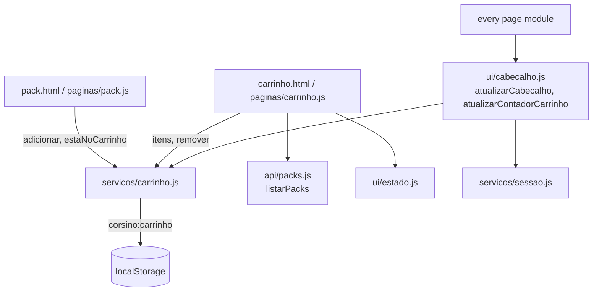

# Shopping Cart - Design

**Spec**: `.specs/features/etapa05-carrinho/spec.md`
**Status**: Draft

---

## Architecture Overview

Applies AD-009. `servicos/carrinho.js` is the only code that touches `localStorage`; pages and the header call it. The cart page asks the API for the packs (prices are never stored in the browser).



---

## Code Reuse Analysis

| Component | Location | How to Use |
| --------- | -------- | ---------- |
| Session module pattern (key, corrupt value removed) | `frontend/servicos/sessao.js` | Same structure for the cart key |
| `atualizarCabecalho`, "Sair" handler | `frontend/ui/cabecalho.js` | Adds the counter; "Sair" also empties the cart |
| `carregarComEstado` | `frontend/ui/estado.js` | Cart page loading/error |
| `listarPacks`, `formatarPreco` | `frontend/api/packs.js`, `frontend/ui/formato.js` | Names and prices on the cart page |
| Pack page info block | `frontend/paginas/pack.js` `mostrarPack` | The button/link goes in `.preset-info`, after the price |
| `.botao-tentar` (primary), `.botao-sair` (quiet) | `frontend/style.css` | Looks of "Adicionar ao carrinho" and "Remover" |
| Header icon style | the "Entrar" SVG (`viewBox 0 0 24 24`, 20 px, `currentColor`, stroke 2) | Same style for the cart icon |

---

## Components

### `servicos/carrinho.js`
- `CHAVE_CARRINHO = 'corsino:carrinho'`
- `itensDoCarrinho(): string[]`: parses the key; not an array, or any item failing `^[a-z0-9]+(-[a-z0-9]+)*$` → removes the key and returns `[]` (CAR-03); duplicates collapse to the first occurrence (EDGE-03).
- `estaNoCarrinho(id): boolean`
- `adicionarAoCarrinho(id): void`: appends if absent (CAR-02).
- `removerDoCarrinho(id): void`: keeps the others in order (CAR-04).
- `esvaziarCarrinho(): void`

### Header markup (every page) and `ui/cabecalho.js`
- New right-hand group in the nav, static in each HTML file so it exists before any script runs:
  ```html
  <div class="acoes-cabecalho">
      <a href="carrinho.html" class="carrinho"><svg …cart icon…/><span class="carrinho-texto">Carrinho (0)</span></a>
      <a href="login.html" class="entrar">…</a>   <!-- not on login.html -->
  </div>
  ```
- Icon: the Lucide "shopping-cart" paths (ISC license), in the same SVG style as the "Entrar" icon. The user may swap in their own drawing later; only the `<path>`/`<circle>` elements change.
- `atualizarContadorCarrinho()`: writes "Carrinho ({N})" into every `.carrinho-texto`.
- `atualizarCabecalho()` calls `atualizarContadorCarrinho()`; "Sair" calls `esvaziarCarrinho()` before going to `index.html` (HDR-04).
- `paginas/login.js` calls `atualizarContadorCarrinho()` (the login page has no "Entrar" link to replace).

### Styles: the header group
- `.acoes-cabecalho` takes over what `.entrar` had: `position: absolute; right: 24px` from tablet up, `position: static` below 768px, with `display: flex; gap: 20px; align-items: center`.
- `.entrar` loses `position`/`right` (it is now inside the group); `.carrinho` copies the `.entrar` text look.
- **Test impact (REG-02):** the five assertions in `tests/responsive.spec.js` that read `getComputedStyle(.entrar).position` now read it from `.acoes-cabecalho`; the geometry assertions on `.entrar` (same line / below the links / no overlap) stay as they are and keep passing because `.entrar` sits inside the group.

### `paginas/pack.js` (extended)
- After `mostrarPack`, `mostrarAcaoCarrinho(pack.id)` fills a `<div class="pack-acao">` inside `.preset-info`:
  - in cart → `<a href="carrinho.html" class="botao-no-carrinho">No carrinho</a>`
  - otherwise → `<button type="button" class="botao-tentar">Adicionar ao carrinho</button>`; on click: `adicionarAoCarrinho`, redraw as the link, write "Pack adicionado ao carrinho." into a `<p role="status" class="pack-aviso">`, `atualizarContadorCarrinho()`.
- `.pack-acao` lives inside the hidden `.preset-topo`, so it never shows in the not-found, loading or error states (ADD-05).

### `carrinho.html` + `paginas/carrinho.js`
- Markup: `<h1>Carrinho</h1>`, `.estado-carga`, `<p class="carrinho-aviso" role="status">` (removed-pack notice), `<p id="contagem-carrinho">`, `<ul class="itens-carrinho">`, `<p class="total-carrinho">`, and `.carrinho-vazio` (hidden): "Seu carrinho está vazio." + link "Ver os packs".
- On load: `itensDoCarrinho()`; empty → empty state, no request (PAGC-04). Otherwise `carregarComEstado({ buscar: listarPacks, aoCarregar })`.
- `aoCarregar(packs)`: maps cart ids to packs in cart order; ids with no pack → `removerDoCarrinho` + notice (PAGC-07); renders items, count, total (`reduce` over `precoCentavos`, integer cents, then `formatarPreco`).
- "Remover": `removerDoCarrinho(id)`, re-render from the in-memory pack list (no new request), `atualizarContadorCarrinho()`; empty → empty state (PAGC-05).

---

## Data Models

```typescript
// localStorage 'corsino:carrinho'
type Carrinho = string[]   // pack ids, in the order they were added, no duplicates
```

---

## Error Handling Strategy

| Error Scenario | Handling | User Impact |
| -------------- | -------- | ----------- |
| Corrupt cart value | Key removed, empty cart | Counter 0, empty cart page |
| Pack id no longer in the API | Removed from the cart on the cart page | Notice "Um pack do seu carrinho não está mais disponível e foi removido." |
| `/packs` fails on the cart page | Error branch of `carregarComEstado`; cart unchanged | Error text + "Tentar novamente" |

---

## Risks & Concerns

| Concern | Location (file:line) | Impact | Mitigation |
| ------- | -------------------- | ------ | ---------- |
| Header layout change | `frontend/style.css:85-99`, `:795-797`; `tests/responsive.spec.js:35,44,57,78` | Responsive position tests read `.entrar` | Move position to `.acoes-cabecalho`; update only the `position` reads, keep the geometry checks (REG-02) |
| Signed-in header replaces `a.entrar` | `frontend/ui/cabecalho.js:9-28` | Replacement must stay inside the group | `replaceWith` keeps the new box in the same parent |
| `localStorage` shared by tests | Playwright gives each test a fresh context | No leak between tests | Nothing to do; tests that need a cart set it in the page |
| Login page has no `.entrar` | `frontend/login.html:14-21` | Counter must still show | Group with only the cart link; `login.js` updates the counter |

---

## Tech Decisions

| Decision | Choice | Rationale |
| -------- | ------ | --------- |
| Cart link in static HTML | Yes, not created by script | Present before the module runs; one place per page, like "Entrar" |
| Re-render after "Remover" | From memory, no request | The prices just came from the API; one load per visit is enough |
| Icon source | Lucide "shopping-cart" (ISC) as a placeholder | Matches the existing icon style; the user can replace the drawing |

> No new project-level decision: AD-009 already says only `servicos/` touches browser storage.
