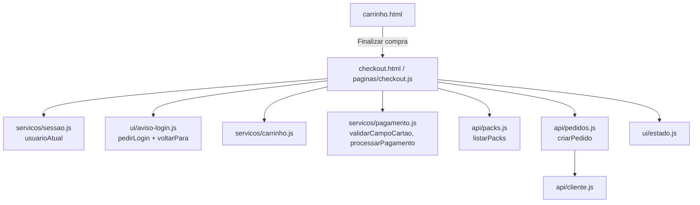

# Checkout and Order - Design

**Spec**: `.specs/features/etapa05-checkout/spec.md`
**Status**: Draft

---

## Architecture Overview

Applies AD-009. The checkout page combines what earlier slices built: the session and login pop-up (slice 2), the pack list and prices (slice 3), the cart (slice 4). Two new pieces: `servicos/pagamento.js` (card rules and the simulated gateway, all in the browser) and `api/pedidos.js` (`POST /pedidos`). Card data stays inside `servicos/pagamento.js` and the form; the order carries none of it.



### Sequence on submit

```
valid form? ── no ──> field messages, stop
   │ yes
button: disabled, "Processando pagamento..."
processarPagamento(numero)  (1500 ms, local)
   ├─ PagamentoRecusado ──> alert "Pagamento recusado...", button back, stop
   └─ approved
        criarPedido({ usuarioId, packIds, totalCentavos, status: 'pago', criadoEm })
          ├─ ErroApi ──> alert "Não foi possível concluir a compra...", button back, stop
          └─ order ──> esvaziarCarrinho(), confirmation, header counter
```

---

## Code Reuse Analysis

| Component | Location | How to Use |
| --------- | -------- | ---------- |
| Field-message helpers (`mostrarErro`, `limparErro`, focus first, re-check on input) | `frontend/paginas/login.js` (validation IIFE) | Same pattern for the card form; copied into `paginas/checkout.js` (two forms, two pages; extracting a shared module is a later refactor) |
| Form alert `.erro-formulario` | `frontend/paginas/login.js` `mostrarAlerta` | Same element and style for declined / failed |
| Pending button | `enviar()` in `paginas/login.js`, `button:disabled` style | Same pattern |
| Cart → packs join, unknown pack notice, total in cents | `frontend/paginas/carrinho.js` `aoCarregar`, `renderizar` | Same logic for the summary |
| `pedirLogin` | `frontend/ui/aviso-login.js` | Gains an optional `voltarPara` (default `index.html`, so the library keeps its behaviour) |
| `carregarComEstado`, `formatarPreco`, `atualizarCabecalho`, `atualizarContadorCarrinho` | `frontend/ui/` | Unchanged |
| Page header markup | `frontend/carrinho.html` | Copied into `checkout.html` |

---

## Components

### `servicos/pagamento.js`
- `class PagamentoRecusado extends Error`
- `TEMPO_PROCESSAMENTO_MS = 1500`
- `validarCampoCartao(campo, valor, hoje = new Date()): string` returns the spec message or `''`; `campo` in `numero | nome | validade | cvv`. Expiry: `^(0[1-9]|1[0-2])\/(\d{2})$`, then `20AA` year and month compared with `hoje` (current month accepted).
- `processarPagamento(numero): Promise<void>`: waits `TEMPO_PROCESSAMENTO_MS` with `setTimeout`, then rejects with `PagamentoRecusado` when the digits end in `0000`, resolves otherwise. No network.

### `api/pedidos.js`
- `criarPedido(pedido): Promise<Pedido>`: `POST /pedidos` as JSON, through `requisicao`.

### `ui/aviso-login.js` (extended)
- `pedirLogin({ mensagem, pagina, voltarPara = 'index.html' })`: "Voltar" and Esc go to `voltarPara`.

### `carrinho.html` / `paginas/carrinho.js` (extended)
- `<a href="checkout.html" class="botao-tentar finalizar">Finalizar compra</a>` inside `.carrinho-lista`, so it shows and hides with the list (CK-01, CK-02).

### `checkout.html` + `paginas/checkout.js`
- Markup: header (copied), `<h1>Finalizar compra</h1>`, `.estado-carga`, notice `role="status"`, `.checkout-resumo` (list + total, hidden), `form#form-pagamento` (hidden, `novalidate`, four labelled fields, submit), `.carrinho-vazio` (hidden), `.checkout-confirmacao` (hidden).
- Load: `atualizarCabecalho()`; no session → `pedirLogin({ mensagem: 'Faça login para finalizar a compra', pagina: 'checkout.html', voltarPara: 'carrinho.html' })` and stop. Empty cart → empty state, stop. Otherwise `carregarComEstado(listarPacks)`; `aoCarregar` reuses the cart join, shows summary and form, sets the button text "Pagar {total}".
- Submit: validate four fields; on success run the sequence above. The form keeps `packIds` and `totalCentavos` from the summary, so the order matches what the visitor saw.
- Confirmation: hides summary and form; shows "Compra aprovada!", "Pedido nº {id}", the packs, the total, link "Ir para a biblioteca".

### Mock data
- `mock/db.seed.json` gets `"pedidos": []`. Tests create orders with the seed user; `npm run api:reset` clears them.

---

## Data Models

```typescript
interface Pedido {
  id: number            // set by json-server
  usuarioId: number
  packIds: string[]     // cart order
  totalCentavos: number
  status: 'pago'
  criadoEm: string      // ISO date-time
}
```

---

## Error Handling Strategy

| Error Scenario | Handling | User Impact |
| -------------- | -------- | ----------- |
| Invalid field | No payment | Field messages, focus on the first |
| Card ending in 0000 | `PagamentoRecusado`, no request | Alert "Pagamento recusado...", cart and values kept |
| `POST /pedidos` fails | `ErroApi` (logged) | Alert "Não foi possível concluir a compra...", cart and values kept |
| `/packs` fails on load | Error branch | Error text + retry, no form |
| No session | Pop-up | "Faça login para finalizar a compra" |

---

## Risks & Concerns

| Concern | Location (file:line) | Impact | Mitigation |
| ------- | -------------------- | ------ | ---------- |
| Card data leaking into a request | `paginas/checkout.js` (new) | Real-world habit risk | `criarPedido` receives an object built from the session and the summary only; a test inspects every request body during a purchase (PAY-04) |
| Testing a 1500 ms wait | `servicos/pagamento.js` | Slow tests | `page.clock` with `pauseAt` (lesson from slice 1) for the timing test; other tests just wait |
| Current-month expiry depends on today | `validarCampoCartao` | Flaky tests near month change | `hoje` parameter in the module test; page tests use a far-future expiry |
| Duplicated validation code | `paginas/login.js` and `paginas/checkout.js` | Two copies of the field-message helpers | Accepted for now (named in Code Reuse); extracting `ui/campos.js` is a small later refactor |
| Dev servers on 3000/8080 | Running for the user | Tests reuse them; the Verifier needs the ports | Tests are fine with them; stop them before the Verifier, as in slice 4 |

---

## Tech Decisions

| Decision | Choice | Rationale |
| -------- | ------ | --------- |
| Where the payment rule lives | `servicos/pagamento.js`, no network | A gateway would be a server call; keeping it a service makes the swap to a real gateway local |
| Order shape | No card field at all | Spec: card data never leaves the browser |
| Empty the cart | After `POST /pedidos` succeeds | A failed request cannot lose the cart or create a second order on retry |

> No new project-level decision.
