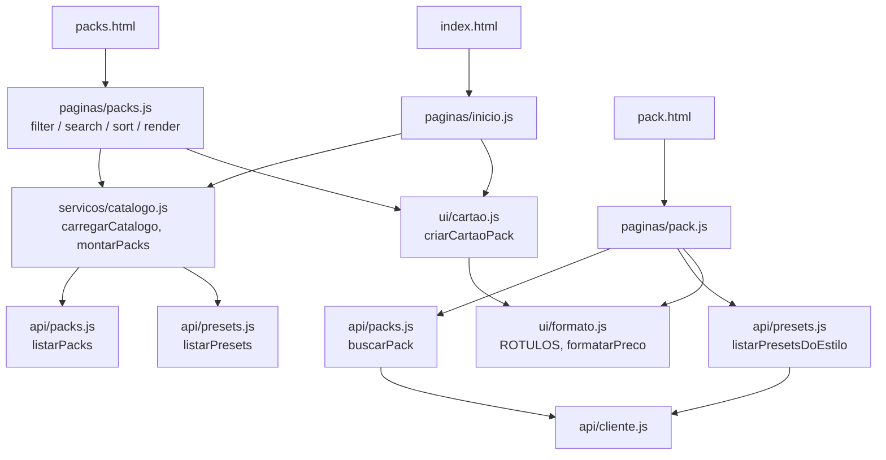

# Style Packs Replace Preset Cards - Design

**Spec**: `.specs/features/etapa05-packs/spec.md`
**Status**: Draft

---

## Architecture Overview

Applies AD-008 and AD-009 unchanged. The list page and the home load packs and presets in parallel and join them in the browser into a **pack view** that already carries what filtering, sorting and the card need. The pack page loads one pack and the presets of its style.



### Pack view (built by `montarPacks`)

```typescript
interface PackView {
  id: string            // 'rock'
  nome: string          // 'Pack Rock'
  descricao: string
  precoCentavos: number // 4990
  presets: Preset[]     // presets with estilo === id
  marcas: string[]      // brand keys present, e.g. ['boss', 'zoom'] (unique)
  data: string          // newest preset date, ISO 'YYYY-MM-DD'
}
```

Naming the newest date `data` keeps `ordenarMaisRecentes` (`b.data.localeCompare(a.data)`) working unchanged for packs.

---

## Code Reuse Analysis

| Component | Location | How to Use |
| --------- | -------- | ---------- |
| List pipeline (criteria → filter → sort → render), reset, submit, live count, empty state | `frontend/paginas/presets.js` | `git mv` to `paginas/packs.js`; `filtrar` and `contemTexto` change to the pack rules (brand: `pack.marcas`, style: `pack.id`, text: pack fields + its presets); `ordenar` keeps the same three branches over `pack.data` / `pack.nome` |
| `carregarComEstado` | `frontend/ui/estado.js` | Unchanged; `buscar` becomes `carregarCatalogo` (one Promise that resolves when both reads do) |
| `listarPresets`, `requisicao`, `ErroApi` | `frontend/api/` | Unchanged; new `api/packs.js` follows `api/presets.js` |
| Card markup and styles `.cartao*` | `frontend/ui/cartao.js`, `style.css` | `criarCartao(preset)` is replaced by `criarCartaoPack(pack)`; same classes plus `.cartao-preco` |
| Page markup | `frontend/presets.html` | `git mv` to `packs.html`; texts "Presets" → "Packs", comments updated |
| Two-column top block | `frontend/preset.html`, `.preset-topo` in `style.css` | Copied into the new `pack.html`; `preset.html` deleted |
| Import-in-page test pattern | `tests/api-usuarios.spec.js` | Same for `api/packs.js` and `servicos/catalogo.js` |
| List tests | `tests/presets-lista.spec.js` | `git mv` to `tests/packs-lista.spec.js` and rewritten per LIST-* (same structure: helpers reading the API, `abrirLista`) |

---

## Components

### `api/packs.js`
- `listarPacks(): Promise<Pack[]>`: `GET /packs`; rejects with `ErroApi` if not a list.
- `buscarPack(id): Promise<Pack | null>`: `GET /packs/{id}`; resolves `null` when `requisicao` rejects with `ErroApi` status 404; other errors propagate.

### `api/presets.js` (extended)
- `listarPresetsDoEstilo(estilo): Promise<Preset[]>`: `GET /presets?estilo={encoded}`; rejects if not a list.

### `servicos/catalogo.js`
- `montarPacks(packs, presets): PackView[]`: pure join; packs without presets get `presets: []`, `marcas: []`, `data: ''`.
- `carregarCatalogo(): Promise<PackView[]>`: `Promise.all([listarPacks(), listarPresets()])` then `montarPacks`. If either read rejects, the whole Promise rejects (EDGE-02).

### `ui/formato.js` (extended)
- `formatarPreco(centavos)`: `new Intl.NumberFormat('pt-BR', { style: 'currency', currency: 'BRL' }).format(centavos / 100)`.

### `ui/cartao.js` (rewritten)
- `criarCartaoPack(pack)`: `<a class="cartao" href="pack.html?id={id}">` with `h2.cartao-nome`, `p.cartao-quantidade` ("3 presets" / "1 preset"), `p.cartao-marcas` (labels, sorted with `localeCompare(…, 'pt-BR')`, joined by ", "), `p.cartao-preco`.
- `ordenarMaisRecentes(lista)`: unchanged.
- `criarCartao` (preset card) is removed.

### `paginas/packs.js`
- Same structure as today's `paginas/presets.js`; `buscar: carregarCatalogo`; messages "Carregando packs..." / "Não foi possível carregar os packs. ..."; count "N packs encontrados" / "1 pack encontrado".

### `paginas/inicio.js`
- `carregarCatalogo` → `ordenarMaisRecentes` → `criarCartaoPack`; same messages as the list.

### `paginas/pack.js` + `pack.html`
- Reads `id` from the URL; if it fails `^[a-z]+$` → not-found state, no request.
- Otherwise `carregarComEstado` with `buscar: () => Promise.all([buscarPack(id), listarPresetsDoEstilo(id)])`; `aoCarregar` shows not-found when the pack is `null`, else fills the info block and the list and sets `document.title`.
- The info block (`.preset-topo`) starts `hidden` and is shown only after a successful load (PAG-08, PAG-09).
- Not-found: `<p>Pack não encontrado.</p><a href="packs.html">Ver todos os packs</a>` inside `.estado-carga`.

### Markup changes on every page
- Menu: `Página Inicial · Packs · Biblioteca` (the "Presets" link is removed, "Packs" points to `packs.html`).
- `index.html`: carousel title "Packs", new hero text, new meta description.

### Styles
- Remove `.preset-download`; add `.cartao-preco`, `.cartao-quantidade`, `.cartao-marcas`, the pack page list (`.pack-presets`), and `button:disabled { opacity: .6; cursor: not-allowed; }`.

---

## Error Handling Strategy

| Error Scenario | Handling | User Impact |
| -------------- | -------- | ----------- |
| `/packs` or `/presets` fails on list/home | `Promise.all` rejects → `carregarComEstado` error branch | One error message + "Tentar novamente" (repeats both) |
| Pack id malformed | No request | "Pack não encontrado." + link |
| Pack id 404 | `buscarPack` → `null` | Same not-found message |
| Pack page network failure | Error branch | "Não foi possível carregar o pack. ..." + retry |

---

## Risks & Concerns

| Concern | Location (file:line) | Impact | Mitigation |
| ------- | -------------------- | ------ | ---------- |
| Large test rewrite | `tests/presets-lista.spec.js` (31 tests) | Easy to lose a behaviour on the way | Rewrite maps each old test to its LIST-* counterpart (table in tasks.md, T3); none is dropped without a replacement |
| Tests hard-coding 9 cards / "presets" texts | `tests/carga-estado.spec.js`, `tests/modulos.spec.js`, `tests/presets-lista.spec.js` | Fail by design | Updated in the task that changes the behaviour |
| Pack page measured before load | `tests/responsive.spec.js:184-202` (`colunasPresetTopo`) | Hidden block has no columns | Helper waits for the pack `<h1>` before measuring |
| Only 4 packs | Sort and filter tests | Fewer items can hide a wrong rule | Expected values derived from the API with the spec rules; tests assert orders that differ between the options (as lesson L-002 requires) |
| Verifier time | Full suite per mutant (~45 s) | 15-20 min per round | Verifier runs only the spec files that cover the mutated module, then one full gate |

---

## Tech Decisions

| Decision | Choice | Rationale |
| -------- | ------ | --------- |
| Join packs and presets | In the browser (`servicos/catalogo.js`) | json-server cannot embed a filtered child list; the join is a few lines and a pure function |
| Pack id | The style key | No extra field on presets; readable URLs |
| 404 handling | `buscarPack` maps 404 to `null` | Not-found is a normal answer for the page, not a communication failure |

> No new project-level decision: the change of what is sold is recorded in `.specs/features/etapa05-loja/plano.md` (section 10).
