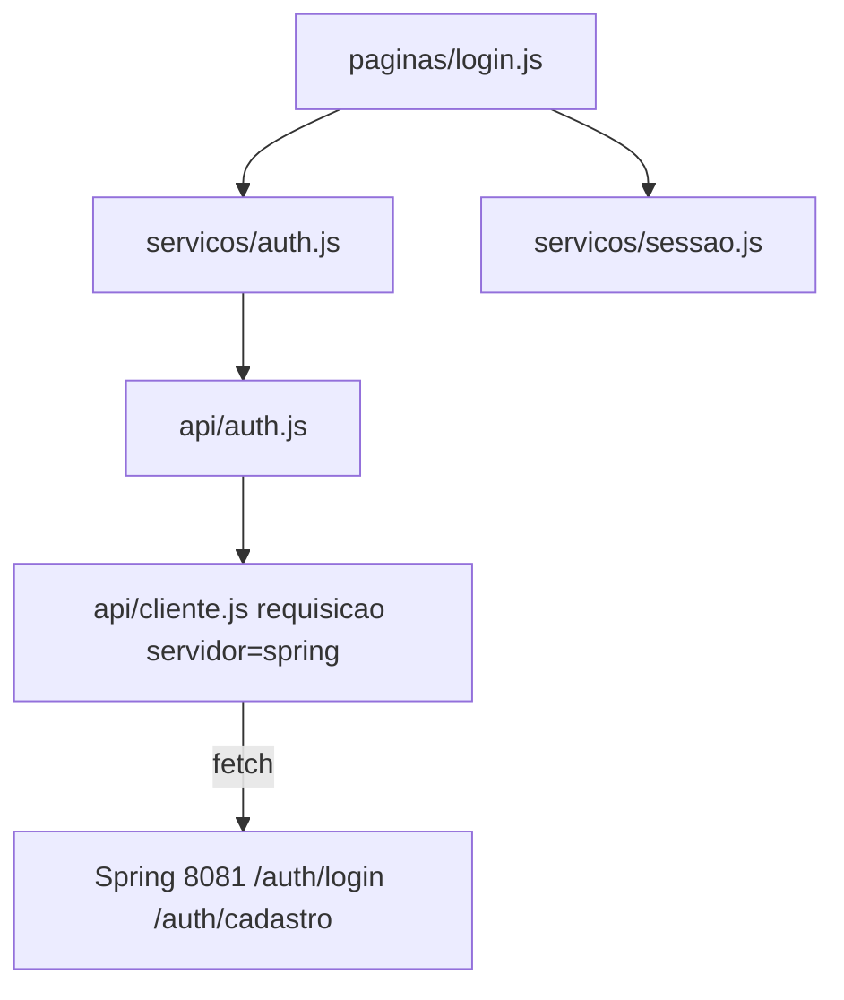

# Legacy Front End on the Spring Auth API Design

**Spec**: `.specs/features/etapa06-front-spring-auth/spec.md`
**Status**: Draft

---

## Architecture Overview

Only the HTTP layer and the auth service change; pages keep calling `entrar` and `cadastrar`.

AD-009 layering holds: only `api/` calls `fetch` (through `cliente.js`), `servicos/` holds the rules (status to error class mapping), the page maps errors to messages. Two servers coexist during the migration (AD-012): the mock (3000) for packs and orders, Spring (8081) for auth.

---

## Code Reuse Analysis

| Component | Location | How to Use |
| --------- | -------- | ---------- |
| `requisicao`, `ErroApi`, `TEMPO_LIMITE_MS` | `frontend/api/cliente.js` | Extend with a `servidor` option and the error body; keep the 8000 ms limit and `console.error` logging |
| `CredenciaisInvalidas`, `EmailEmUso` | `frontend/servicos/auth.js` | Keep; map `401` and `409` onto them |
| Field messages and pending text | `frontend/paginas/login.js` (`mostrarErro`, `TEXTO_PENDENTE`, `MSG_CONEXAO`) | Reuse for server `campos` errors |
| Spring contract | `.specs/features/etapa06-spring-cadastro/spec.md` | Status codes and `{status, mensagem, campos}` body |
| Test style | `tests/api-cliente.spec.js`, `tests/auth.spec.js`, `tests/login-api.spec.js` | Same host-page imports and `page.route` interception, now on 8081 |

---

## Components

### `api/cliente.js` (modify)
- `SPRING_URL = 'http://127.0.0.1:8081'` next to `BASE_URL`.
- `requisicao(caminho, opcoes)` accepts `opcoes.servidor` (`'spring'` selects `SPRING_URL`; default stays the mock) and strips it before `fetch`.
- `ErroApi` gains `corpo` (parsed JSON of a non-2xx answer, or `null`), so callers can read `campos`.

### `api/auth.js` (new, replaces `api/usuarios.js`)
- `entrarNoServidor({email, senha}): Promise<{token, usuario}>` -> `POST /auth/login`.
- `cadastrarNoServidor({nome, email, senha}): Promise<{id, nome, email}>` -> `POST /auth/cadastro`.
- Pure HTTP: JSON headers and body, no rules.

### `servicos/auth.js` (modify)
- `entrar(email, senha)`: `entrarNoServidor`; `ErroApi` status 401 -> `CredenciaisInvalidas`; 400 with `campos` -> `DadosInvalidos(campos)`; resolves `{id, nome, email}`.
- `cadastrar({nome, email, senha})`: `cadastrarNoServidor`; 409 -> `EmailEmUso`; 400 -> `DadosInvalidos`; resolves `{id, nome, email}`. Name and e-mail are sent as typed (the server trims and lower-cases); the password is never trimmed.
- `DadosInvalidos` (new exported error) carries `campos`.

### `paginas/login.js` (modify)
- `tratarFalha` handles `DadosInvalidos`: for each key of `campos` it shows the message on the matching field (login: `email`, `senha`; registration: `nome`, `email`, `senha` -> `cadastro-nome`, `cadastro-email`, `cadastro-senha`) and focuses the first one.

### Server and test infrastructure
- `backend/.../SegurancaConfig.java`: add `http://127.0.0.1:8080` and `http://127.0.0.1:5173` to the allowed origins.
- `playwright.config.js`: third `webServer` for Spring (`command: 'cd backend && ./mvnw -q spring-boot:run'`, `port: 8081`, `env.CORSINO_JWT_SECRET` test value, `reuseExistingServer`, timeout 120 s).

---

## Error Handling Strategy

| Error Scenario | Handling | User Impact |
| -------------- | -------- | ----------- |
| 401 on login | `CredenciaisInvalidas` | "E-mail ou senha incorretos." and password cleared |
| 409 on registration | `EmailEmUso` | Message on the e-mail field |
| 400 with `campos` | `DadosInvalidos` | Each message on its field |
| Network error, timeout, 5xx, 400 without `campos`, 404 | `ErroApi` | "Não foi possível conectar ao servidor. Tente novamente." |

---

## Risks & Concerns

| Concern | Location | Impact | Mitigation |
| ------- | -------- | ------ | ---------- |
| Page tests that intercept the mock's `/usuarios` break the moment the service switches | `tests/login-api.spec.js`, `tests/login-validacao.spec.js`, `tests/ajustes.spec.js`, `tests/auth.spec.js` | Red suite between tasks | Phase 2 tasks use their own quick gate; the last task of the phase runs the full suite |
| Spring users are in memory and shared by every test and worker | Spring server | A repeated e-mail would give a false `409` | Unique e-mails in every registering test (existing `emailUnico` helper) |
| Starting Spring through Maven adds 10-20 s to a cold run | `playwright.config.js` | Slow first run, timeouts | 120 s start timeout and `reuseExistingServer` |
| Spring URL is hard coded to `127.0.0.1:8081` | `api/cliente.js` | Needs editing for another host | Same single-place rule as `BASE_URL` (AD-008) |
| `127.0.0.1` and `localhost` are different CORS origins | `SegurancaConfig` | Browser blocks calls | Both origins allowed (WEB-13), tested |

---

## Tech Decisions

| Decision | Choice | Rationale |
| -------- | ------ | --------- |
| Choosing the server per call | `servidor` option of `requisicao` | Keeps one `fetch` site and one error type (AD-009) |
| Carrying the 400 body | `ErroApi.corpo` | The service needs `campos`; avoids a second error channel |
| Token | Discarded by the service | Nothing consumes it yet (spec out of scope) |

> **Project-level decision**: AD-012 (two API servers, URLs in `cliente.js`) is appended to `.specs/STATE.md`.
