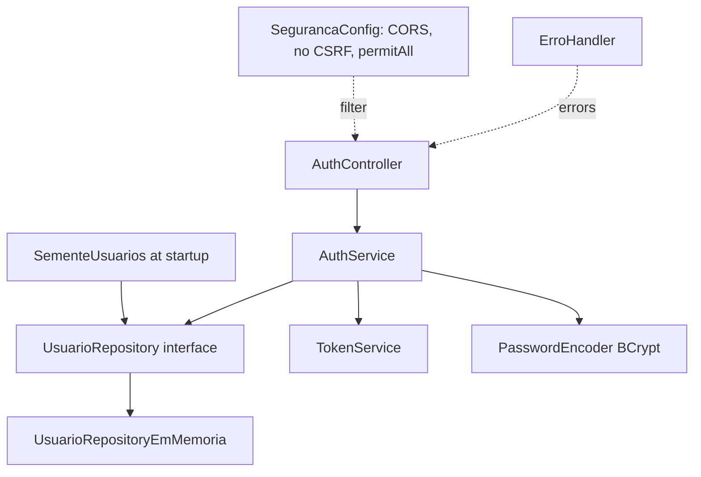

# Spring Boot Skeleton, Registration and Login API Design

**Spec**: `.specs/features/etapa06-spring-cadastro/spec.md`
**Status**: Draft

---

## Architecture Overview

Spring MVC as a REST API (AD-010). A request crosses four layers and each depends only on the one below it:



- **Controller** parses and validates the JSON body (`@Valid` on DTO records) and calls one service method. No rules.
- **Service** holds the rules: normalise the e-mail, hash, reject a duplicate, compare a password, issue a token.
- **Repository** is an interface. The only implementation keeps users in memory (AD-010); PostgreSQL replaces it later.
- **Model** is the `Usuario` record (id, nome, email, senhaHash). DTOs are the JSON shapes and never carry the hash.

Approaches considered for the token (the only real fork): (a) Spring Security's own JWT support (`spring-security-oauth2-jose`, Nimbus inside), chosen; (b) the `jjwt` library, rejected because it adds a second JWT stack beside the one Spring Security already ships and will need for protected routes; (c) hand-built HMAC token, rejected as home-made crypto.

---

## Code Reuse Analysis

### Existing Components to Leverage

| Component | Location | How to Use |
| --------- | -------- | ---------- |
| Registration rules and messages | `frontend/paginas/login.js:57-67` | Copy the regex, minimums and the two e-mail/password texts so server and form agree |
| `normalizarEmail` | `frontend/servicos/auth.js:21` | Same trim + lower-case rule in `AuthService` |
| `CredenciaisInvalidas`, `EmailEmUso` texts | `frontend/servicos/auth.js:11-23` | Same messages as the server's `401` and `409` |
| Seed users | `mock/db.seed.json` (`usuarios`) | Read-only input of `SementeUsuarios` |
| JSON field names (`nome`, `email`, `senha`, `id`) | `frontend/api/usuarios.js` | DTO field names, so the front end can switch later |

### Integration Points

| System | Integration Method |
| ------ | ------------------ |
| Legacy front end (8080) and Vite (5173) | Browser calls with CORS allowed for those two origins (SRV-04); not wired in this part |
| json-server mock (3000) | Untouched; only its seed file is read |

---

## Components

All under `backend/src/main/java/com/corsinotones/`.

### AuthController (`controller/`)
- **Purpose**: HTTP entry of `/auth`.
- **Interfaces**: `POST /auth/cadastro(CadastroRequest): 201 UsuarioResponse`; `POST /auth/login(LoginRequest): 200 LoginResponse`.
- **Dependencies**: `AuthService`.

### ErroHandler (`controller/`, `@RestControllerAdvice`)
- **Purpose**: the single error body `{status, mensagem, campos}` (SRV-05).
- **Mapping**: `MethodArgumentNotValidException` -> 400 with `campos`; `HttpMessageNotReadableException` -> 400 "Corpo da requisição inválido."; `EmailEmUso` -> 409; `CredenciaisInvalidas` -> 401; `NoResourceFoundException` -> 404 "Rota não encontrada."; `HttpRequestMethodNotSupportedException` -> 405 "Método não permitido."; any other `Exception` -> 500 "Erro interno do servidor." (logged, no stack trace in the body).

### AuthService (`service/`)
- **Interfaces**: `cadastrar(CadastroRequest): Usuario` (normalise, hash with `PasswordEncoder`, `repositorio.criar`, throws `EmailEmUso` when the repository says the e-mail exists); `entrar(LoginRequest): Sessao` where `Sessao(Usuario, token)` (unknown e-mail and wrong password both throw `CredenciaisInvalidas`).
- **Dependencies**: `UsuarioRepository`, `PasswordEncoder`, `TokenService`.

### TokenService (`service/`)
- **Interfaces**: `gerar(Usuario): String` — HS256 JWT, `sub`=id as text, `nome`, `email`, `iat`, `exp`=`iat`+2h.
- **Dependencies**: `JwtEncoder`, `Clock` (injected so tests fix the time).

### UsuarioRepository (`repository/`) and UsuarioRepositoryEmMemoria
- **Interfaces**: `Optional<Usuario> buscarPorEmail(String email)`; `Optional<Usuario> criar(String nome, String email, String senhaHash)` returns empty when the e-mail exists, otherwise stores the user with id = largest id + 1; `void carregar(Usuario)` for the seed.
- **Concurrency (CAD-12)**: `criar` and `carregar` are `synchronized` on the instance, so the e-mail check, the max-id read and the insert are one step; `buscarPorEmail` reads a `ConcurrentHashMap`.

### SementeUsuarios (`repository/`, `ApplicationRunner`)
- **Purpose**: SEED-01 to SEED-04. Reads `usuarios` from the file in `corsino.seed.arquivo` with Jackson, hashes each plain password, calls `carregar`. Missing file -> warning log, no users. Never opens the file for writing.

### SegurancaConfig (`config/`)
- `SecurityFilterChain`: CSRF off (stateless API, no cookies), `anyRequest().permitAll()`, CORS from a `CorsConfigurationSource` allowing origins `http://localhost:8080` and `http://localhost:5173`, methods `POST` and `OPTIONS`, header `Content-Type`. `PasswordEncoder` bean = `BCryptPasswordEncoder`.

### JwtConfig (`config/`)
- Reads `corsino.jwt.secret` (`${CORSINO_JWT_SECRET:}`); IF blank or shorter than 32 characters THEN throws `IllegalStateException("CORSINO_JWT_SECRET ...")` so the context fails to start (LOG-09). Exposes `JwtEncoder` (Nimbus, HS256) and a `Clock` bean.

### DTOs (`dto/`)
- `CadastroRequest(nome, email, senha)`: compact constructor trims `nome` and `email` (null stays null); annotations `@NotNull` plus `@Size` / `@Pattern` carry the exact messages of CAD-04 to CAD-06, so a missing field fails with its rule's message (CAD-08).
- `LoginRequest(email, senha)`: trims `email`; `@NotEmpty` on both with the LOG-06 messages (the e-mail format is not checked on login).
- `UsuarioResponse(id, nome, email)`, `LoginResponse(token, usuario)`, `ErroResposta(status, mensagem, campos)`.

---

## Data Models

```java
record Usuario(long id, String nome, String email, String senhaHash) {}
```

No relationships yet. E-mail uniqueness is the repository's rule, on the normalised e-mail.

---

## Error Handling Strategy

| Error Scenario | Handling | User Impact |
| -------------- | -------- | ----------- |
| Invalid field(s) | 400, one entry per field in `campos` | Form can show each message |
| Broken JSON | 400, "Corpo da requisição inválido." | Generic message |
| Duplicate e-mail | 409, "Este e-mail já está cadastrado." | Same text as today |
| Wrong login | 401, "E-mail ou senha incorretos." | Same text as today |
| Unknown route / method | 404 / 405 in the same body | Consistent errors |
| Unexpected exception | 500 "Erro interno do servidor.", logged server-side | No internals leak |
| Missing JWT secret | App refuses to start, names `CORSINO_JWT_SECRET` | Fails loudly, not silently with a weak key |

---

## Risks & Concerns

| Concern | Location | Impact | Mitigation |
| ------- | -------- | ------ | ---------- |
| Plain passwords in the seed | `mock/db.seed.json` | Mock-only weakness, already recorded in `frontend/servicos/auth.js:3` | Server hashes on load and never writes the seed (SEED-01, SEED-04) |
| Login timing differs for unknown e-mail (no hash computed) | `AuthService.entrar` | Lets an attacker probe which e-mails exist | Compare against a fixed dummy hash when the e-mail is unknown; covered by a test that the encoder is called in both paths |
| Boot 4.0.9 ships Spring Security 7, where `NimbusJwtEncoder.withSecretKey` is documented (since 7.0); test starters and some test packages were renamed in Boot 4 | `JwtConfig`, tests | A wrong class or package name would not compile | Confirm names against the Boot 4 and Security 7 docs at T5, T8 and T16 |
| Jackson accepts unknown or duplicate fields silently | DTOs | Extra fields ignored | Accepted: the front end sends only the three fields; not a spec requirement |
| No test suite exists in `backend/` yet | whole part | none | Created here with the user's go-ahead (spec assumption); user approved the spec |

---

## Tech Decisions (only non-obvious ones)

| Decision | Choice | Rationale |
| -------- | ------ | --------- |
| Spring Boot line | 4.0.9 (changed from 3.5.x during T1) | Initializr only offers 4.x and 3.5 is out of open-source support; Spring Security 7 has `withSecretKey` |
| Starters | `web`, `validation`, `security`, `test`, `spring-security-test`, plus `spring-security-oauth2-jose` | Security brings BCrypt and the filter chain; oauth2-jose brings the JWT encoder/decoder |
| Dummy hash for unknown e-mails | Compute one at startup and compare against it | Equalises login time (see Risks) |

> **Project-level decisions** (AD-010 MVC layers with an in-memory repository interface, AD-011 JWT with Spring Security and an environment secret) are appended to `.specs/STATE.md`.
