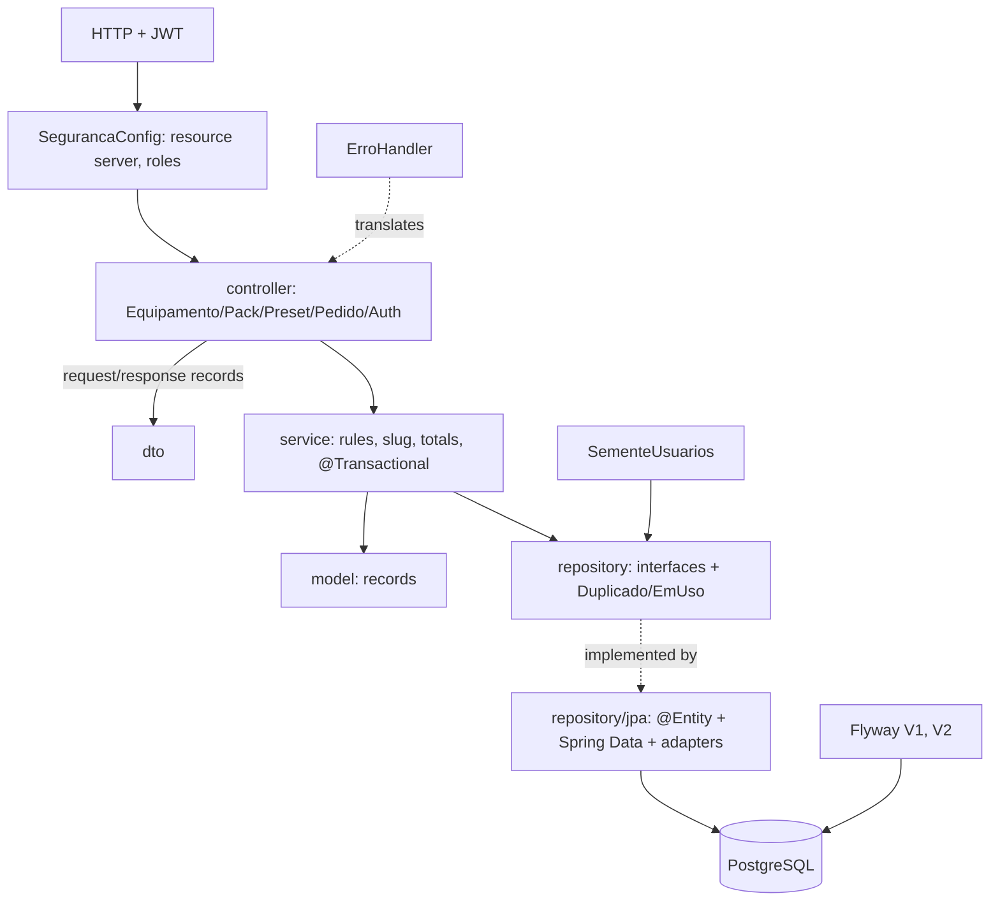
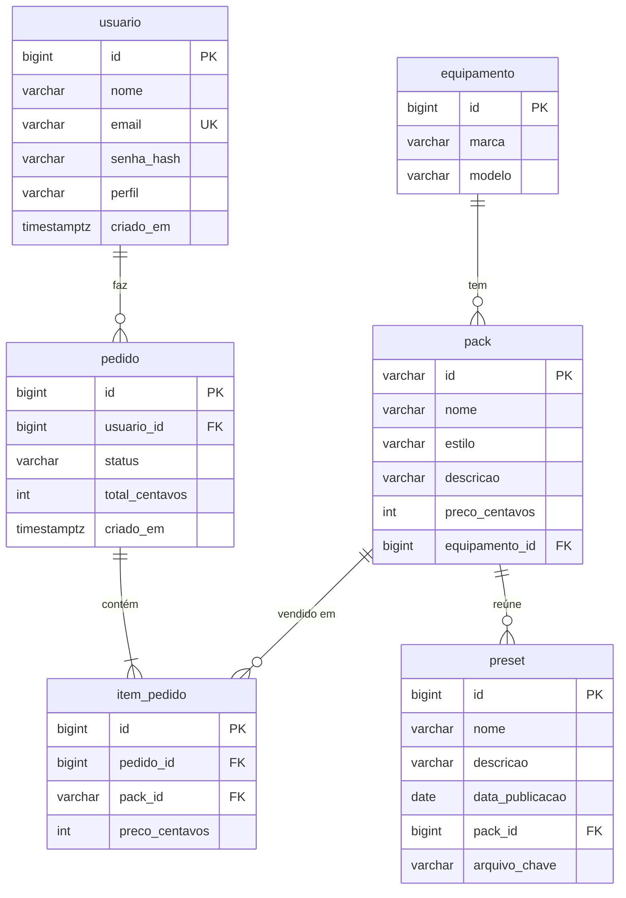

# Stage 07 Persistence - Design

**Spec**: `.specs/features/etapa07-persistencia/spec.md`
**Context**: `.specs/features/etapa07-persistencia/context.md`
**Status**: Draft

---

## Architecture Overview

The layers of AD-010 stay. `model` keeps plain Java records with no persistence annotations. The database lives only inside `repository`: each repository interface (ours) gets one adapter in `repository/jpa/`, which owns the `@Entity` classes, a package-private Spring Data interface and the conversion between entity and record. Services see records and our own exceptions; controllers see services and DTOs.

Chosen with the user over "entities as the model": records keep `AuthService` and the auth tests unchanged (USR-08), Hibernate's lazy proxies never leave the repository, and the stage's "no coupling between API and database" requirement is visible in the package layout (ARQ-01 to ARQ-03). The cost is one entity class and one conversion per table.

---

## Code Reuse Analysis

### Existing Components to Leverage

| Component | Location | How to Use |
| --------- | -------- | ---------- |
| `UsuarioRepository` interface | `backend/src/main/java/com/corsinotones/repository/UsuarioRepository.java` | Kept; gains `vazio()`. New JPA adapter implements it |
| `SementeUsuarios` | `repository/SementeUsuarios.java` | Kept; skips when `vazio()` is false; sets `perfil` from `corsino.seed.admins` |
| `AuthService` | `service/AuthService.java` | Unchanged (USR-08) |
| `TokenService` | `service/TokenService.java` | Adds the `perfil` claim (USR-06) |
| `JwtConfig.jwtDecoder()` | `config/JwtConfig.java` | Reused by the resource server to validate tokens |
| `ErroHandler`, `ErroResposta` | `controller/ErroHandler.java`, `dto/ErroResposta.java` | Extended with `NaoEncontrado`, `Conflito`, `CampoInvalido`, 401/403/503 and bad path ids |
| Bean Validation records | `dto/CadastroRequest.java` | Same style (messages as constants, trimming in the compact constructor) for the new request records |
| Layer test by reflection | `controller/AuthControllerCadastroTest.java:141` | Superseded by a source-import scan that covers every package (ARQ-01) |
| Mock seed | `mock/db.seed.json` | Source of the hand-written `V2__catalogo_inicial.sql` |

### Integration Points

| System | Integration Method |
| ------ | ------------------ |
| PostgreSQL 16 | `spring.datasource.*` from `CORSINO_DB_*`; Flyway migrates at startup; Hibernate validates |
| Legacy front end | Unchanged in this slice; JSON keeps the mock's field names so AD-012 can later move each resource |
| Playwright (`playwright.config.js`) | The Spring web server now needs PostgreSQL up and `CORSINO_DB_PASSWORD` in the environment |

---

## Components

### Migrations

- **Purpose**: Own the schema and the initial catalogue.
- **Location**: `backend/src/main/resources/db/migration/V1__criar_tabelas.sql`, `V2__catalogo_inicial.sql`
- **Interfaces**: Named constraints, read by the adapters to translate errors: `uk_usuario_email`, `uk_equipamento_marca_modelo`, `uk_pack_estilo_equipamento`, `uk_item_pedido_pack`, `fk_pack_equipamento`, `fk_preset_pack`, `fk_pedido_usuario`, `fk_item_pedido_pedido`, `fk_item_pedido_pack`.
- **Dependencies**: Flyway starter + `flyway-database-postgresql` (Boot 4 needs both for PostgreSQL).
- **Reuses**: Values of `mock/db.seed.json`.

### model (records)

- **Purpose**: The domain as the services see it.
- **Location**: `backend/src/main/java/com/corsinotones/model/`
- **Interfaces**: `Usuario(long id, String nome, String email, String senhaHash, Perfil perfil)`, `enum Perfil {COMUM, ADMIN}`, `Equipamento(long id, String marca, String modelo)`, `Pack(String id, String nome, String estilo, String descricao, int precoCentavos, Equipamento equipamento)`, `Preset(long id, String nome, String descricao, LocalDate data, Pack pack)`, `Pedido(long id, long usuarioId, StatusPedido status, int totalCentavos, Instant criadoEm, List<ItemPedido> itens)`, `ItemPedido(String packId, int precoCentavos)`, `enum StatusPedido {PENDENTE, PAGO}` (JSON and column value lower-case).
- **Reuses**: `Usuario` record (gains `perfil`).

### repository (interfaces and errors)

- **Purpose**: Storage contracts, free of JPA types.
- **Location**: `backend/src/main/java/com/corsinotones/repository/`
- **Interfaces**:
  - `UsuarioRepository`: existing methods + `boolean vazio()`. `criar` now lets the database assign the id.
  - `EquipamentoRepository`: `List<Equipamento> listar()`, `Optional<Equipamento> buscar(long id)`, `Equipamento criar(String marca, String modelo)`, `Equipamento atualizar(Equipamento e)`, `void excluir(long id)`, `boolean temPacks(long id)`.
  - `PackRepository`: `listar()`, `buscar(String id)`, `List<Pack> buscarVarios(Collection<String> ids)`, `criar(Pack p)`, `atualizar(Pack p)`, `excluir(String id)`, `boolean emUso(String id)` (has presets or order items), `boolean existeEstiloNoEquipamento(String estilo, long equipamentoId, String exceto)`.
  - `PresetRepository`: `listar()`, `listarPorPack(String packId)`, `buscar(long id)`, `criar(Preset p)`, `atualizar(Preset p)`, `excluir(long id)`.
  - `PedidoRepository`: `Pedido criar(long usuarioId, StatusPedido status, int total, Instant criadoEm, List<ItemPedido> itens)`, `List<Pedido> listarDoUsuario(long usuarioId, Optional<StatusPedido> status)`, `Optional<Pedido> buscarDoUsuario(long id, long usuarioId)`.
  - `Duplicado(String restricao)` and `EmUso(String restricao)`: unchecked, thrown by adapters when PostgreSQL rejects a write for a named unique or foreign key.
- **Dependencies**: `model` only.

### repository/jpa (adapters)

- **Purpose**: The only code that knows JPA, Hibernate and SQL.
- **Location**: `backend/src/main/java/com/corsinotones/repository/jpa/`
- **Interfaces**: one `XEntidade` (`@Entity`) + package-private `XJpa extends JpaRepository` + public `XRepositoryJpa implements XRepository` per table; `TradutorDeErros.traduzir(DataIntegrityViolationException)` reads the constraint name and throws `Duplicado` or `EmUso`.
- **Rules**:
  - Writes use `saveAndFlush` / `delete` + `flush`, so a constraint violation surfaces inside the adapter method, where it is translated, and not at commit.
  - Reads that the JSON needs use fetch joins (`preset → pack → equipamento`, `pack → equipamento`, `pedido → itens`) to avoid N+1 queries.
  - `UsuarioRepositoryJpa.carregar` inserts the seed row with its explicit id through a native `INSERT`, then moves the identity past the largest id (`ALTER TABLE ... RESTART` equivalent via `setval`), so `criar` gives 2 next (USR-02).
- **Reuses**: nothing; replaces `UsuarioRepositoryEmMemoria`.

### service

- **Purpose**: Rules, ids, totals and transactions.
- **Location**: `backend/src/main/java/com/corsinotones/service/`
- **Interfaces**:
  - `EquipamentoService`, `PackService`, `PresetService`: `listar`, `buscar`, `criar`, `atualizar`, `excluir`, each turning a missing row into `NaoEncontrado(msg)`, a duplicate into `Conflito(msg)` (both the pre-check and a caught `Duplicado`, ERR-04), a blocked delete into `Conflito(msg)` (pre-check and caught `EmUso`, ERR-05), and an unknown referenced id into `CampoInvalido(campo, msg)`.
  - `PackService.slug(String estilo, String marca, String modelo)`: NFD, drop combining marks, lower-case, runs of `[^a-z0-9]` to `-`, trim `-` (PCK-03).
  - `PedidoService.criar(long usuarioId, List<String> packIds)` (`@Transactional`): checks empty and repeated ids, loads the packs, reports the first unknown id in request order, sums prices, stores status `PAGO` with `Clock` time.
  - `PedidoService.listar(long usuarioId, Optional<StatusPedido>)`, `buscar(long id, long usuarioId)`.
  - Exceptions `NaoEncontrado`, `Conflito`, `CampoInvalido`; `EmailEmUso` becomes a `Conflito`.
- **Dependencies**: `repository` interfaces, `model`, `Clock`. `@Transactional` comes from `org.springframework.transaction`, which ARQ-01 allows.

### controller + dto

- **Purpose**: HTTP mapping only.
- **Location**: `controller/EquipamentoController.java`, `PackController.java`, `PresetController.java`, `PedidoController.java`; `dto/` request and response records.
- **Interfaces**: the routes of the spec. The signed-in user's id is `Long.parseLong(jwt.getSubject())` from `@AuthenticationPrincipal Jwt`.
- **DTO rules**: `PackRequest.precoCentavos` is a `BigDecimal` with `@NotNull @Digits(integer = 7, fraction = 0) @DecimalMin("0") @DecimalMax("1000000")`, so `49.5` reaches validation instead of being truncated by Jackson (PCK-09). `PresetRequest.data` is a `String` checked by a small `@DataIso` constraint (`LocalDate.parse` in strict ISO mode), so `2026-02-30` lands in `campos.data` (PRS-09). Responses are built by `XResponse.de(record)`.

### Security

- **Purpose**: Who can call what (ERR-01 to ERR-03, ERR-09).
- **Location**: `config/SegurancaConfig.java` (modify)
- **Interfaces**: `oauth2ResourceServer(jwt)` with a converter mapping the `perfil` claim to `ROLE_COMUM` / `ROLE_ADMIN`; rules: `/auth/**` and `GET` catalogue routes permit all; catalogue `POST`/`PUT`/`DELETE` `hasRole("ADMIN")`; `/pedidos/**` authenticated; anything else permit all (so unknown routes still reach the 404 handler, SRV-05). An `AuthenticationEntryPoint` and an `AccessDeniedHandler` write `ErroResposta` with 401 "Faça login para continuar." and 403 "Acesso restrito ao administrador.". CORS gains `GET`, `PUT`, `DELETE` and the `Authorization` header.
- **Dependencies**: `spring-boot-starter-security-oauth2-resource-server`, `JwtConfig.jwtDecoder()`.

### Configuration

- **Location**: `backend/src/main/resources/application.properties`, `config/BancoConfig.java`, repo-root `docker-compose.yml`, `.env.example`, `.gitignore`.
- **Values**: `spring.datasource.url=${CORSINO_DB_URL:jdbc:postgresql://localhost:5433/corsinotones}`, `username=${CORSINO_DB_USER:corsino}`, `password=${CORSINO_DB_PASSWORD:}`, `spring.jpa.hibernate.ddl-auto=validate`, `spring.jpa.open-in-view=false`, `corsino.seed.admins=ryan@exemplo.com`. `BancoConfig` fails startup with "CORSINO_DB_PASSWORD must be set (database connection jdbc:...)" when the password is blank (DB-09).

### Test infrastructure

- **Location**: `backend/src/test/java/com/corsinotones/BancoDeTeste.java`, `BancoIsolado.java`
- **Interfaces**:
  - `BancoDeTeste`: `@TestConfiguration` with one JVM-wide `postgres:16-alpine` container exposed through `@ServiceConnection`; every `@SpringBootTest` imports it. Tests that write use unique names or e-mails and never assert totals.
  - `BancoIsolado`: a fresh container per Spring context, for tests that need an empty or freshly migrated database (seed tests, USR-02, DB-06 restart, ERR-06 stop, PED-10 trigger).
  - Migration tests (DB-01 to DB-05, DB-07) run Flyway's Java API against their own container, without Spring.
  - Surefire sets `CORSINO_DB_PASSWORD=test` so `BancoConfig` passes; the service connection overrides the real credentials.

---

## Data Models

- Ids: `BIGINT GENERATED BY DEFAULT AS IDENTITY`, except `pack.id` (`VARCHAR(80)`, the slug). `V2` inserts explicit ids and restarts the identities (`equipamento` at 5, `preset` at 22).
- Checks: `usuario.perfil IN ('COMUM','ADMIN')`, `pedido.status IN ('pendente','pago')`, `preco_centavos >= 0` on `pack` and `item_pedido`, `total_centavos >= 0`.
- `ON DELETE CASCADE` only on `item_pedido.pedido_id`; every other foreign key is `RESTRICT`.
- Indexes on the foreign keys PostgreSQL does not index on its own: `pack(equipamento_id)`, `preset(pack_id)`, `pedido(usuario_id)`, `item_pedido(pack_id)`.

---

## Error Handling Strategy

| Error Scenario | Handling | User Impact |
| -------------- | -------- | ----------- |
| Bean Validation fails | `MethodArgumentNotValidException` (existing) | `400` with every field in `campos` |
| Referenced id unknown (`equipamentoId`, `packId`, `packIds`) | `CampoInvalido` from the service | `400` with that field |
| Row not found | `NaoEncontrado` | `404` with the resource message |
| Duplicate found by the service pre-check | `Conflito` | `409` |
| Duplicate missed by the pre-check (race) | Adapter catches `DataIntegrityViolationException`, throws `Duplicado(uk_*)`; service maps to `Conflito` | `409`, same message |
| Delete blocked by a child row | Pre-check, or `EmUso(fk_*)` from the adapter | `409` |
| Bad path id type | `MethodArgumentTypeMismatchException` | `400` "Identificador inválido." |
| No / invalid / expired token | Entry point | `401` |
| `COMUM` on an admin route | Access-denied handler | `403` |
| Database down at runtime | `DataAccessResourceFailureException` and `CannotCreateTransactionException` | `503`, no SQL or stack trace |
| Any other failure, including a rolled-back order (PED-10) | Existing catch-all | `500` "Erro interno do servidor." |
| Database missing at startup | `BancoConfig` (password) / Flyway connection error (URL) | App does not start |

---

## Risks & Concerns

| Concern | Location (file:line) | Impact | Mitigation |
| ------- | -------------------- | ------ | ---------- |
| Every existing `@SpringBootTest` now needs a database | `backend/src/test/java/com/corsinotones/**` | 76 tests fail without Docker | T-infra task adds `BancoDeTeste` and imports it in each test class; README states Docker must run |
| Seed tests assume a fresh store | `repository/SementeUsuarios*Test.java` | A shared database already has users, so "seed loads" and "missing file → no users" become order-dependent | These classes move to `BancoIsolado` |
| `CAD-11` tests assert "largest id + 1" | `controller/AuthControllerCadastroTest.java` | Fail with identity ids | Rewritten to USR-02 on `BancoIsolado` |
| `UsuarioRepositoryEmMemoria` stops being a runtime bean, but `AuthServiceTest` uses it as its fake | `repository/UsuarioRepositoryEmMemoria.java`, `service/AuthServiceTest.java:28` | USR-08 forbids its runtime use; deleting it breaks the unit tests | Move it to `src/test/java` (same package, no `@Repository`) with its own test; new service unit tests follow the same pattern with in-memory fakes (the project has no Mockito tests). **Needs the user's go-ahead** (file not created in this session) |
| Playwright starts Spring with only the JWT secret | `playwright.config.js:41` | Spring fails to start without the database | Pass `CORSINO_DB_PASSWORD` through from the shell; README: run `docker compose up -d` first |
| Local PostgreSQL cluster uses port 5432 | `pg_lsclusters`: 16/main | Port clash with the dev container | Compose publishes `5433:5432` and the default URL uses 5433; Testcontainers picks random ports |
| The 503 mapping depends on which exception Spring raises when Hikari cannot connect | `ErroHandler` | A wrong guess answers 500 | ERR-06 test stops a real container; handle `DataAccessResourceFailureException` and `CannotCreateTransactionException`, adjust if the test shows another type |
| Jackson truncates `49.5` into an `int` | `PackRequest` | PCK-09 would accept a fraction | `BigDecimal` + `@Digits(fraction = 0)` |
| Invalid token on a public `GET` | resource-server filter | `401` even on a public route | Spec ERR-01 now says "without a token or with a valid one" |
| `spring-boot:run` in Playwright reuses an existing database | dev PostgreSQL | Users registered by tests pile up across runs | Tests already use unique e-mails; harmless |

---

## Tech Decisions (only non-obvious ones)

| Decision | Choice | Rationale |
| -------- | ------ | --------- |
| Where constraint errors are translated | Inside the adapter, with `saveAndFlush` | At commit the exception would surface in the service, which must not import Spring Data or Hibernate |
| Error type for duplicates | Adapter throws `Duplicado(restricao)`, service picks the message | Only the service knows which resource message applies |
| Order total | Computed from the database, `item_pedido.preco_centavos` frozen | The client must not set prices (spec) |
| Migration testing | Flyway Java API on its own container, no Spring | Exact counts need an untouched database; faster than a full context |
| PED-10 test | A test-only PostgreSQL trigger raises on `item_pedido` insert for one pack id | Forces a failure after the `pedido` row is written, without production hooks |
| Architecture test | Scan `src/main/java` imports per package | Covers all controllers and services, which the reflection check at `AuthControllerCadastroTest.java:141` did not (etapa06 gap SRV-03) |

Project-level decisions recorded in `.specs/STATE.md`: AD-013 (PostgreSQL + Flyway own the schema), AD-014 (pure records + JPA adapters), AD-015 (resource server and roles), AD-016 (Testcontainers as the backend gate).
