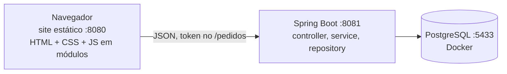

# Etapa 06 — O site inteiro conversa com o Spring Boot #

Na primeira parte da etapa 06 só o cadastro e o login passavam pela API Spring Boot;
packs, presets, carrinho, compra e biblioteca ainda vinham de uma API simulada
(json-server, porta 3000). Esta parte conclui a etapa: **todo o front-end fala só com o
Spring**, que guarda os dados no PostgreSQL desde a etapa 07, e a API simulada foi
removida do projeto.

Especificação: `.specs/features/etapa06-front-spring-loja/spec.md`.

---

## Arquitetura ##



Antes, `frontend/api/cliente.js` tinha duas URLs e cada chamada escolhia o servidor.
Agora há uma só, `BASE_URL = 'http://127.0.0.1:8081'`. As camadas do front-end
continuam as mesmas: `paginas/` usa `servicos/` e `api/`, e só `api/` faz `fetch`.

| Parte do site | Antes | Agora |
| ------------- | ----- | ----- |
| Cadastro e login | Spring | Spring; a sessão passa a guardar o token |
| Catálogo (início, packs, pack) | json-server | `GET /packs`, `GET /presets` no Spring |
| Compra (checkout) | `POST /pedidos` no json-server, com usuário e total enviados pelo navegador | `POST /pedidos` no Spring, só com `packIds` e o token; o servidor define dono, preços, total e status |
| Biblioteca e "Na biblioteca" | `GET /pedidos?usuarioId=` no json-server | `GET /pedidos?status=pago` com o token; o servidor lê o usuário do token |
| Download de preset | gerado no navegador | sem mudança (os arquivos reais virão com o MinIO, numa etapa futura) |

### O token na sessão ###

O Spring só aceita `/pedidos` com o **token JWT** (credencial assinada que o login
devolve) no cabeçalho `Authorization: Bearer <token>`. Como o site tem várias
páginas, o token fica na sessão da aba (`sessionStorage`), junto com nome e e-mail, e
some ao clicar em "Sair" ou fechar a aba. A senha nunca é guardada no navegador, e o
token nunca vai para o `localStorage`.

O cadastro não devolve token, então o site faz login logo depois de criar a conta,
com o mesmo e-mail e senha.

Se o servidor responder `401` (token vencido ou inválido), a página encerra a sessão
e leva ao login, com `?voltar=` apontando para onde o usuário estava. O carrinho
fica guardado e continua lá depois do novo login.

---

## Como executar ##

Requer Docker, JDK 21, Node.js e Python 3. Na raiz do projeto:

```bash
cp .env.example .env
```

Troque `POSTGRES_PASSWORD` no `.env` e suba o banco:

```bash
docker compose up -d
```

Em um terminal, a API (porta 8081):

```bash
cd backend
export CORSINO_JWT_SECRET="um-segredo-local-com-pelo-menos-32-caracteres"
export CORSINO_DB_PASSWORD="$(grep '^POSTGRES_PASSWORD=' ../.env | cut -d= -f2-)"
./mvnw spring-boot:run
```

Em outro terminal, o site (porta 8080):

```bash
python3 -m http.server 8080
```

Abra <http://127.0.0.1:8080/frontend/index.html>. A conta de teste é
`ryan@exemplo.com` com a senha `teste123`.

---

## Exemplos com `curl` ##

Respostas reais, obtidas com a API rodando sobre o banco do `docker compose`.

Cadastro e login de um novo cliente:

```bash
curl -s -X POST http://127.0.0.1:8081/auth/cadastro -H 'Content-Type: application/json' \
  -d '{"nome":"Bia Doc","email":"doc-1795635158@exemplo.com","senha":"senha-doc-123"}'
```

```text
HTTP 201
{"id":204,"nome":"Bia Doc","email":"doc-1795635158@exemplo.com"}
```

```bash
TOKEN=$(curl -s -X POST http://127.0.0.1:8081/auth/login -H 'Content-Type: application/json' \
  -d '{"email":"doc-1795635158@exemplo.com","senha":"senha-doc-123"}' | python3 -c 'import sys,json;print(json.load(sys.stdin)["token"])')
```

### Criar um pedido ###

O navegador envia só os packs. Dono, preços, total, status e data vêm do servidor:

```bash
curl -s -X POST http://127.0.0.1:8081/pedidos -H "Authorization: Bearer $TOKEN" \
  -H 'Content-Type: application/json' -d '{"packIds":["rock-zoom-g6","clean-nux-mg-30"]}'
```

```text
HTTP 201
{"id":80,"usuarioId":204,"packIds":["rock-zoom-g6","clean-nux-mg-30"],"totalCentavos":9980,"status":"pago","criadoEm":"2026-11-25T19:32:39.638999Z"}
```

### Listar os pedidos pagos (a biblioteca) ###

```bash
curl -s "http://127.0.0.1:8081/pedidos?status=pago" -H "Authorization: Bearer $TOKEN"
```

```text
HTTP 200
[{"id":80,"usuarioId":204,"packIds":["rock-zoom-g6","clean-nux-mg-30"],"totalCentavos":9980,"status":"pago","criadoEm":"2026-11-25T19:32:39.638999Z"}]
```

### Erros que o site trata ###

Sem token, `401`. A página encerra a sessão e leva ao login:

```text
HTTP 401
{"status":401,"mensagem":"Faça login para continuar.","campos":{}}
```

Um pack que não existe mais, `400`. O checkout mostra a mensagem e mantém o carrinho:

```text
HTTP 400
{"status":400,"mensagem":"Dados inválidos.","campos":{"packIds":"Pack não encontrado: nao-existe."}}
```

---

## O que saiu do projeto ##

- A pasta `mock/` (`db.json`, `db.seed.json`, `preparar.js`), os scripts
  `npm run api`, `api:lento` e `api:reset` e a dependência `json-server`.
- O servidor da API simulada no `playwright.config.js`.
- Os testes do próprio mock (`tests/api-mock.spec.js`).

O usuário de teste, que o Spring lia de `mock/db.seed.json`, agora fica em
`backend/src/main/resources/semente/usuarios.json` e é carregado quando a tabela de
usuários está vazia.

---

## Como testar ##

```bash
cd backend && ./mvnw -q clean test
```

```bash
docker compose up -d
export CORSINO_DB_PASSWORD="$(grep '^POSTGRES_PASSWORD=' .env | cut -d= -f2-)"
npx playwright test
```

O Playwright sobe sozinho o site e o Spring. Os testes criam os próprios usuários e
pedidos pela API (`tests/apoio/api.js`), porque o banco é compartilhado entre
execuções. O `PersistenciaAposReinicioTest` prova que um pedido feito pela API
continua igual depois de reiniciar o Spring.
