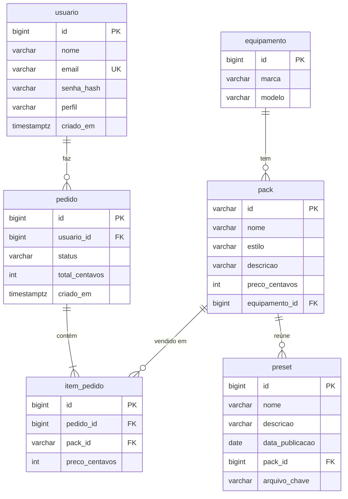

# Etapa 07 — Persistência com PostgreSQL #

O servidor Spring Boot deixou de guardar dados na memória. Usuários, equipamentos,
packs, presets e pedidos agora ficam em um **PostgreSQL 16**, e um dado criado pela
API continua lá depois que a aplicação é reiniciada. Quem cria e altera as tabelas
é o **Flyway** (ferramenta que aplica scripts SQL versionados em ordem), e o
Hibernate só confere se o esquema bate com o código (`ddl-auto=validate`).

Especificação: `.specs/features/etapa07-persistencia/spec.md`.

---

## Modelo de dados ##



### Entidades ###

- **usuario:** quem tem conta. A senha é guardada só como hash BCrypt. O `perfil` é
  `COMUM` ou `ADMIN`; o cadastro sempre cria `COMUM`, e só a carga inicial dá `ADMIN`.
- **equipamento:** o aparelho para o qual um pack foi feito (marca e modelo, por
  exemplo Boss GT-1000). A dupla marca + modelo é única.
- **pack:** um conjunto de presets de um estilo, com preço em centavos. O `id` é um
  texto legível (`rock-boss-gt-1000`), montado a partir do estilo e do equipamento.
- **preset:** um timbre de um pack. `arquivo_chave` guarda só a chave do arquivo,
  que vai ficar no MinIO (armazenamento de arquivos); o conteúdo nunca vai para o banco.
- **pedido:** uma compra de um usuário, com status (`pendente` ou `pago`) e o total
  calculado pelo servidor.
- **item_pedido:** um pack dentro de um pedido, com o **preço da hora da compra**.
  Mudar o preço do pack depois não altera pedidos antigos.

### Relacionamentos ###

| Relação | Cardinalidade | Regra ao excluir |
| ------- | ------------- | ---------------- |
| equipamento → pack | um para muitos | não exclui equipamento que tem packs |
| pack → preset | um para muitos | não exclui pack que tem presets |
| usuario → pedido | um para muitos | não exclui usuário que tem pedidos |
| pedido → item_pedido | um para muitos (ao menos um) | excluir o pedido leva os itens junto |
| pack → item_pedido | um para muitos | não exclui pack que já foi vendido |

Só `item_pedido.pedido_id` apaga em cascata. Todas as outras chaves estrangeiras
bloqueiam a exclusão, e a API responde `409`.

---

## Como criar o banco ##

Requer Docker. Na raiz do projeto:

```bash
cp .env.example .env
```

Troque o valor de `POSTGRES_PASSWORD` no `.env` (ele não vai para o git). Depois:

```bash
docker compose up -d
```

Isso sobe o PostgreSQL na porta **5433** do computador. Em seguida, inicie a API com
a mesma senha. Na primeira subida o Flyway cria as seis tabelas (`V1`) e carrega o
catálogo inicial (`V2`: 4 equipamentos, 9 packs e 21 presets):

```bash
cd backend
export CORSINO_JWT_SECRET="um-segredo-local-com-pelo-menos-32-caracteres"
export CORSINO_DB_PASSWORD="<a senha do .env>"
./mvnw spring-boot:run
```

Sem `CORSINO_DB_PASSWORD` a aplicação não inicia e a mensagem diz qual variável
faltou. A URL e o usuário têm padrão (`CORSINO_DB_URL`, `CORSINO_DB_USER`).

---

## Exemplos com `curl` ##

Todas as respostas abaixo foram obtidas rodando a API sobre o banco do
`docker compose`. Criar, alterar e excluir pack exigem um token de **administrador**:

```bash
TOKEN=$(curl -s -X POST http://127.0.0.1:8081/auth/login \
  -H 'Content-Type: application/json' \
  -d '{"email":"ryan@exemplo.com","senha":"teste123"}' | python3 -c 'import sys,json;print(json.load(sys.stdin)["token"])')
```

### Criar um pack ###

```bash
curl -i -X POST http://127.0.0.1:8081/packs \
  -H "Authorization: Bearer $TOKEN" -H 'Content-Type: application/json' \
  -d '{"nome":"Funk Clássico","estilo":"funk","descricao":"Timbres limpos e secos para groove.","precoCentavos":4990,"equipamentoId":1}'
```

```text
HTTP 201
{"id":"funk-boss-gt-1000","nome":"Funk Clássico","estilo":"funk","marca":"boss","equipamento":"GT-1000","equipamentoId":1,"descricao":"Timbres limpos e secos para groove.","precoCentavos":4990}
```

### Ler um pack (público) ###

```bash
curl -i http://127.0.0.1:8081/packs/funk-boss-gt-1000
```

```text
HTTP 200
{"id":"funk-boss-gt-1000","nome":"Funk Clássico","estilo":"funk","marca":"boss","equipamento":"GT-1000","equipamentoId":1,"descricao":"Timbres limpos e secos para groove.","precoCentavos":4990}
```

### Atualizar um pack ###

```bash
curl -i -X PUT http://127.0.0.1:8081/packs/funk-boss-gt-1000 \
  -H "Authorization: Bearer $TOKEN" -H 'Content-Type: application/json' \
  -d '{"nome":"Funk Clássico","estilo":"funk","descricao":"Timbres limpos e secos para groove.","precoCentavos":5990,"equipamentoId":1}'
```

```text
HTTP 200
{"id":"funk-boss-gt-1000","nome":"Funk Clássico","estilo":"funk","marca":"boss","equipamento":"GT-1000","equipamentoId":1,"descricao":"Timbres limpos e secos para groove.","precoCentavos":5990}
```

### Excluir um pack ###

Um pack novo (`jazz`), que ninguém comprou:

```bash
curl -i -X DELETE http://127.0.0.1:8081/packs/jazz-boss-gt-1000 -H "Authorization: Bearer $TOKEN"
```

```text
HTTP 204
```

Lido de novo, ele não existe mais:

```text
HTTP 404
{"status":404,"mensagem":"Pack não encontrado.","campos":{}}
```

Um pack que já está em um pedido não pode ser excluído:

```text
HTTP 409
{"status":409,"mensagem":"Este pack tem presets ou pedidos e não pode ser excluído.","campos":{}}
```

### Criar um pedido ###

Só os packs vêm do cliente. O dono (do token), os preços, o total, o status e a hora
são definidos pelo servidor, e qualquer um deles enviado no corpo é ignorado:

```bash
curl -i -X POST http://127.0.0.1:8081/pedidos \
  -H "Authorization: Bearer $TOKEN" -H 'Content-Type: application/json' \
  -d '{"packIds":["rock-boss-gt-1000","funk-boss-gt-1000"]}'
```

```text
HTTP 201
{"id":1,"usuarioId":1,"packIds":["rock-boss-gt-1000","funk-boss-gt-1000"],"totalCentavos":10980,"status":"pago","criadoEm":"2026-11-25T18:14:05.772926Z"}
```

Sem token, a resposta é `401`:

```text
HTTP 401
{"status":401,"mensagem":"Faça login para continuar.","campos":{}}
```

---

## Por que PostgreSQL e não um banco NoSQL ##

Os dados deste projeto são **relacionais**: as seis tabelas se ligam por chaves
estrangeiras (um pedido pertence a um usuário e contém packs; um pack pertence a um
equipamento e reúne presets). O PostgreSQL faz o próprio banco recusar o que não
faz sentido, como um pedido de usuário inexistente ou um pack apagado enquanto há
pedidos que o citam. Em um banco de documentos (como o MongoDB), essas regras
passariam para o código da aplicação.

Outros motivos: o pedido e seus itens são gravados em **uma transação**, então uma
falha no meio desfaz tudo; o preço do item fica gravado no momento da compra, um
modelo de linhas e colunas natural; e o SQL permite filtros e junções (pedidos de um
usuário por status) sem estruturas extras. O custo aceito é manter um serviço a mais
(o contêiner do Docker) e escrever as mudanças de esquema como migrações.

Os **arquivos** dos presets ficam fora do banco, no MinIO: guardar o conteúdo em
`bytea` incharia o banco e os backups. A tabela guarda só a chave em `arquivo_chave`.

---

## Como testar ##

Os testes do servidor rodam contra um PostgreSQL real, criado por Testcontainers
(biblioteca que sobe um contêiner Docker só para o teste), então o Docker precisa
estar ligado:

```bash
cd backend && ./mvnw -q clean test
```

O teste `PersistenciaAposReinicioTest` cria um equipamento e um usuário pela API,
para a aplicação, sobe de novo no mesmo banco e confere que os dois continuam lá. O
`ArquiteturaTest` garante que só a camada `repository` conhece o banco.

A suíte do front-end continua passando (354 testes) com o Spring sobre o PostgreSQL:

```bash
docker compose up -d
export CORSINO_DB_PASSWORD="<a senha do .env>"
npx playwright test
```
